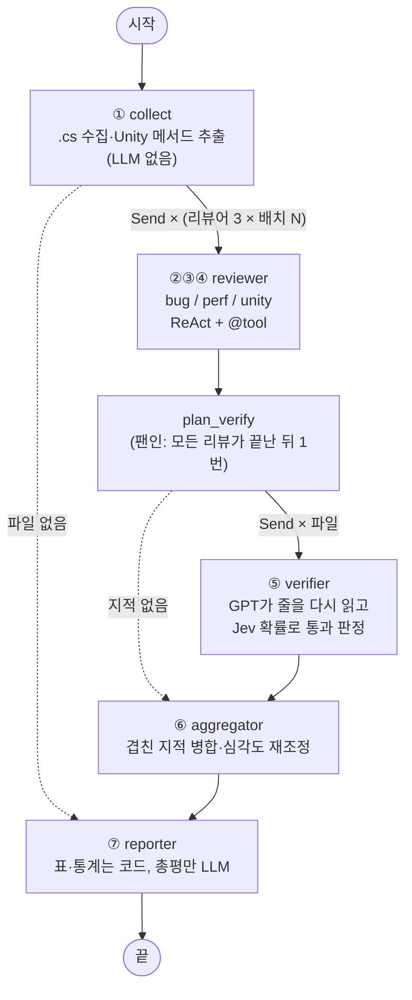

# Desert Chess Code Reviewer — Unity C# 코드 리뷰 멀티에이전트

Unity 프로젝트의 C# 스크립트 폴더를 넣으면 **버그 · 성능 · Unity 안티패턴** 리뷰어 3명이 동시에 코드를 읽습니다. 이어서 **검증 에이전트**가 지적마다 실제 코드를 다시 읽어 오탐을 걸러 내고, **취합 에이전트**가 겹친 지적을 합쳐 우선순위별 리뷰 리포트를 씁니다.

```bash
uv run -m app.main "C:/Project_Game/Desert Chess/dessert chess/Desert-Chess/Assets/01. Script"
# → output/<실행 시각>/review_report.md, findings.json, status.json, messages.json
```

---

## 1. 프로젝트 소개 — 무엇을 해결하는가

| 상황 | 문제 |
| --- | --- |
| 데저트 체스는 **2인 팀**이 기획과 개발을 함께 함 | 서로의 코드를 꼼꼼히 리뷰할 사람과 시간이 없음 |
| Unity는 **에러 없이 조용히 틀리는** 코드가 많음 | 자식 오브젝트에 `DontDestroyOnLoad` → 경고만 뜨고 무시됨 (**실제로 겪은 사례**). `Update`마다 `GetComponent`, 이벤트 구독 후 해제 누락, 파괴된 `UnityEngine.Object`에 `?.` 사용 등 |
| 일반 린터(Roslyn 분석기)는 **Unity 생명주기 맥락**을 모름 | "이 메서드는 매 프레임 호출된다", "이 싱글턴은 씬 재로드 시 중복된다" 같은 판단을 못 함 |
| LLM 한 번에 전체 코드를 넣으면 | 컨텍스트가 넘치고, 관점이 섞여 얕은 리뷰가 되며, **존재하지 않는 줄을 지적하는 환각**이 생김 |

→ **관점별 전문 리뷰어를 병렬로 돌리고, 지적마다 실제 코드로 다시 검증**하는 구조로 해결합니다.

## 2. Agent 구조



(`uv run -m app.graph.builder` 로 LangGraph가 그린 mermaid 원본을 출력할 수 있습니다.)

### 노드별 역할

| # | 노드 | LLM | 입력 → 출력 | 핵심 |
| --- | --- | --- | --- | --- |
| ① | `collect` | ✗ | 폴더 → `files`, `batches` | `*.cs`만, `Editor/` 등 제외. UTF-8 BOM·CRLF 처리. 클래스·상속·Unity 메시지 메서드(`Awake/Update/...`)와 줄 범위를 정규식으로 뽑아 리뷰어 힌트로 줌(매 프레임 호출은 `*`). 줄 수 600줄 기준으로 배치 |
| ② | `reviewer`(bug) | ✓ | 배치 → `raw` | NullReference, 초기화 순서, 이벤트 해제 누락, foreach 중 수정, 인덱스 경계, 상태 머신 |
| ③ | `reviewer`(perf) | ✓ | 배치 → `raw` | `Update` 안 `GetComponent`/`Find*`, 매 프레임 할당, 문자열 `Animator` 파라미터, `Instantiate/Destroy` 남발 |
| ④ | `reviewer`(unity) | ✓ | 배치 → `raw` | 자식 `DontDestroyOnLoad`, 싱글턴 중복, `UnityEngine.Object`에 `?.`/`??`, `CompareTag`, `Time.deltaTime` 누락 |
| ⑤ | `verifier` | ✓ + Jev | 파일별 지적 → `verified` / `rejected` | GPT 검증자가 `read_file`로 그 줄을 다시 읽고 존재·타당성을 판정, **Jev(TypeSafe)** 가 타당할 확률을 매겨 0.5 미만은 기각. 줄 번호 오류는 근거 코드로 다시 찾아 고침 |
| ⑥ | `aggregator` | ✓ | `verified` → `final` | 같은 파일에서 줄이 겹치는 지적을 코드로 묶고, 묶음만 LLM에 보내 같은 문제끼리 합침(예: perf·unity가 같은 `GetComponent` 지적). P0~P3 재조정, 정렬, `BUG-001` 같은 id는 코드가 붙임 |
| ⑦ | `reporter` | △ | `final` → 파일 | 표·건수·시간·토큰은 파이썬이 만들고 총평 3~5문장만 LLM. Jev로 리포트 실행 가능성 점수(0~3)를 `status.json`에 기록 |

### 리뷰어가 쓰는 도구 (`app/tools/code_tools.py`)

모든 도구는 **리뷰 루트 밖을 읽지 못하게** 경로를 검사하고, 모델에게는 루트 기준 상대경로만 보여 줍니다(한글·공백이 든 절대경로는 모델이 옮겨 적다 깨뜨리기 쉬움).

| 도구 | 하는 일 | 쓰는 담당 |
| --- | --- | --- |
| `read_file(path, start, end)` | 줄번호가 붙은 코드 (`   42│ code`), 최대 300줄 | 리뷰어 3명, 검증자 |
| `grep_code(pattern)` | 정규식으로 `파일:줄: 내용` 최대 50건 — 호출하는 곳·선언 위치 찾기 | 리뷰어 3명 |
| `list_files(subdir)` | `.cs` 상대경로 목록 | 리뷰어 3명 |
| `get_unity_methods(path)` | 클래스·상속, Unity 메시지 메서드와 줄 범위 | 리뷰어 3명 |

검증자는 **읽기 도구 하나만** 받습니다(starter의 `ALLOWED_TOOLS` 패턴).

### 배운 내용 적용 매핑

| 배운 것 | 적용 위치 |
| --- | --- |
| **LangGraph StateGraph + 리듀서** | `graph/state.py` — 병렬 결과를 `merge_by_key`(키별 dict 병합), `operator.add`(기각·오류 누적), `add_messages`(대화 기록)로 모음 |
| **병렬 실행 (`Send`) + 팬인** | `graph/edges.py` — 리뷰어 × 배치, 파일별 검증을 `Send`로 팬아웃. `reviewer → plan_verify` 일반 엣지로 모든 리뷰가 끝난 뒤 한 번만 분기 |
| **`create_agent` + 미들웨어** | `agents/workers.py` — `ModelCallLimitMiddleware`(에이전트 1회당 모델 호출 12번 상한), `wrap_tool_call`(도구 호출 수 집계 → `status.json`) |
| **`@tool` 도구 / ReAct** | `tools/code_tools.py` — 리뷰어·검증자가 필요할 때 다른 파일을 찾아 읽음 |
| **구조화 출력 (Pydantic)** | `core/schemas.py` — 에이전트의 텍스트 답 → `ReviewBatch`/`VerifyResult`/`MergeDecision`으로 변환. id·분류·통계는 코드가 정함 |
| **LLM-as-judge (Jev)** | `core/judge.py` — 지적 타당성 확률(`Noul`)로 검증 통과를 코드 가드가 결정, 리포트 품질 점수(`Score`) |
| **레이어드 구조** | `core → tools → agents → graph → main` (starter와 동일) |
| **관측 (Langfuse)** | `.env`에 키가 있으면 `CallbackHandler`를 실행 config에 붙여 리뷰어별 트레이스를 남김 |

## 3. 실행 방법

### 준비

1. **Python 3.12**, **[uv](https://docs.astral.sh/uv/)**
2. 의존성 설치: `uv sync`
3. `.env.example`을 `.env`로 복사하고 키를 채웁니다. (`.env`는 `.gitignore`에 있어 커밋되지 않습니다. **`.env`가 없으면 import 단계에서 멈춥니다**)
   - macOS / Linux: `cp .env.example .env` · Windows PowerShell: `Copy-Item .env.example .env`

| 키 | 필수 | 용도 |
| --- | --- | --- |
| `OPENAI_API_KEY` | ✅ | 리뷰어·검증자·취합자·총평 |
| `OPENAI_CHAT_MODEL` | | 기본 `gpt-5.6-luna` (Responses API로 호출 — 이 모델은 Chat Completions로는 도구 호출이 막혀 있음) |
| `TYPESAFE_API_KEY` | ✅ | Jev 판정 |
| `TYPESAFE_MODEL` | | 기본 `jev-1.13.0` |
| `LANGFUSE_PUBLIC_KEY`, `LANGFUSE_SECRET_KEY`, `LANGFUSE_BASE_URL` | 선택 | 실행 추적 |

### 실행

```bash
# 의도적 버그를 심은 테스트 파일
uv run -m app.main "fixtures/SeededBugs"

# 내 Unity 프로젝트 (공백·한글 경로는 따옴표로)
uv run -m app.main "D:/MyGame/Assets/Scripts"

# 옵션
uv run -m app.main "<폴더>" --only bug,perf          # 일부 리뷰어만
uv run -m app.main "<폴더>" --files "00. Player/*.cs" # 일부 파일만 (루트 기준 glob)
uv run -m app.main "<폴더>" --max-files 30           # 비용 제한
uv run -m app.main "<폴더>" --exclude "Editor,Plugins" # 제외 폴더

# fixtures 탐지율 계산 (가장 최근 실행 기준)
uv run python scripts/eval_fixtures.py
```

진행 로그는 노드 이름으로 시작합니다 (`collect:`, `reviewer:`, `plan_verify:`, `verifier:`, `aggregator:`, `reporter:`).

### 결과물 (`output/<실행 시각>/`)

| 파일 | 내용 |
| --- | --- |
| `review_report.md` | 요약 표 → 총평 → P0~P3 지적(위치·이유·수정 제안·근거 코드) → 파일별 표 → 기각된 지적과 사유 |
| `findings.json` | 최종 지적과 기각 목록 (기계용) |
| `status.json` | 건수, 소요 시간, 모델별 토큰, 도구 호출 수, 실패 기록, Jev 리포트 점수 |
| `messages.json` | 리뷰어·검증자 에이전트 대화 기록 (디버깅용) |

예시: [`output/sample/`](output/sample/) (fixtures 실행 결과)

## 4. 결과

모델 `gpt-5.6-luna`, Jev `jev-1.13.0`, 동시 실행 4.

### 4.1 fixtures 탐지율 — 의도적 버그 11건 + 함정 1건

[`fixtures/SeededBugs/`](fixtures/SeededBugs/)에 C# 파일 5개로 버그 11건을 심고, 정상 코드 함정 1건(`WeaponSeed.Reload`)을 넣었습니다. 정답지는 [`expected.json`](fixtures/SeededBugs/expected.json)이고, `scripts/eval_fixtures.py`가 **파일 + 줄(±3) + 분류 + 제목 키워드**로 자동 매칭합니다.

| # | 심은 문제 | 기대 분류 | 최종 코드 실행 1 | 실행 2 |
| --- | --- | --- | --- | --- |
| 1 | 부모가 있는(자식) 오브젝트에 `DontDestroyOnLoad` — **실제 사례 재현** | unity | ✅ | ✅ |
| 2 | 싱글턴 중복 시 `Destroy` 없음 | unity/bug | ✅ | ✅ |
| 3 | `Update`에서 `GetComponent<Rigidbody2D>()` | perf | ✅ | ✅ |
| 4 | `Animator.SetBool("IsFire")` 문자열 매 프레임 | perf | ✅ | ✅ |
| 5 | `Update`에서 물리 이동, `Time.deltaTime` 없음 | unity/bug | ✅ | ✅ |
| 6 | `OnEnable`에서 이벤트 `+=`, 해제 없음 | bug | ✅ | ✅ |
| 7 | `target?.position` (UnityEngine.Object에 `?.`) | unity | ✅ | ✅ |
| 8 | `foreach` 중 `List.Remove` | bug | ✅ | ✅ |
| 9 | `Update`에서 `FindObjectOfType` + 보간 문자열 | perf | ✅ | ✅ |
| 10 | `tag == "Player"` | unity/perf | ✅ | ✅ |
| 11 | 사용 횟수 감소 후 0 검사 없이 배열 접근 | bug | ✅ | ✅ |
| 함정 | `WeaponSeed.Reload` (정상 코드) | — | 오탐 없음 | 오탐 없음 |

**최종 코드로 두 번 실행해 두 번 모두 11/11 (목표 8 이상), 함정 오탐 0건.** 정답 밖 지적은 실행마다 2건이었고, 둘 다 실제로 있는 문제였습니다(매 프레임 HP 문자열 갱신, MonoBehaviour public 필드). 결과 파일은 [`output/sample/`](output/sample/)에 있습니다. 개선 과정(4.3) 중의 실행은 8~11/11이었습니다.

### 4.2 데저트 체스 실전 리뷰 (`Assets/01. Script`)

| 항목 | 값 |
| --- | --- |
| 리뷰 파일 | 65개 (6,942줄, 배치 15개 × 리뷰어 3명 = 리뷰어 실행 45회) |
| 리뷰어 지적 → 최종 | 39건 → **30건** (검증 기각 1, 병합 8) |
| 등급별 | P0 0 · P1 20 · P2 7 · P3 3 |
| 분류별 | 버그 14 · 성능 6 · Unity 10 |
| 소요 시간 · 토큰 | 293초 · 약 160만 토큰 (대부분 캐시 읽기) |
| 도구 호출 | `read_file` 138 · `grep_code` 41 · `list_files` 12 (리뷰어가 다른 파일 맥락을 직접 확인) |
| Jev 리포트 실행 가능성 점수 | 2.76 / 3 |

**사람 확인 (무작위 10건)**: 타당 **7건**, 부당 3건 → 목표(7건 이상)를 겨우 달성했습니다.
- 부당 1, 2: `Mathf.Sign(0)` 때문에 스케일이나 방향이 0이 된다는 지적 2건. Unity의 `Mathf.Sign(0)`은 1을 돌려주므로 틀린 지적입니다.
- 부당 3: `HitBox.AttackInfo`가 null이라는 지적. `AttackInfo`는 struct라서 null이 될 수 없습니다.
- 같은 날 검증자를 더 엄격하게 둔 실행(4.3 마지막 줄 이전 설정)에서는 타당률이 **8/10**이었고, 그때 검증자는 같은 `Mathf.Sign(0)` 지적을 실제로 기각했습니다. 검증 기준을 느슨하게 하면 fixtures 탐지율이 오르고, 엄격하게 하면 실전 정확도가 오르는 트레이드오프가 있었습니다(4.3).

**대표 지적 3건** (짧은 발췌)

| id | 위치 | 내용 |
| --- | --- | --- |
| BUG-010 (P1) | `99. Util/SimpleInput.cs:67-75` | `GetMouseButtonUp`과 `GetMouseButton`이 둘 다 `wasPressedThisFrame`을 돌려줌 → 버튼을 뗀 순간과 누르고 있는 상태를 감지하지 못함 (`wasReleasedThisFrame`, `isPressed`로 수정) |
| BUG-009 (P1) | `99. Util/RoundManager.cs:149-153` | `SpawnEnemy()`가 프리팹이나 스폰 위치가 없어 일찍 return해도 `spawnedThisRound += 1`이 실행됨 → 실제로는 덜 스폰되고 라운드가 일찍 끝날 수 있음 |
| UNITY-001 (P1) | `00. Player/Player.cs:69-72` | `Awake`에서 `LocalPlayer = this;`만 하고 중복 검사가 없어서, 두 번째 Player가 생기면 정적 참조를 덮어씀 |

리뷰 결과를 보고 게임 저장소 `feature/ai-code-review` 브랜치에서 P1 2건을 고쳤습니다(회복량이 홀수일 때 팝업이 실제보다 크게 표시되는 문제, 흡수 팝업이 이미 멈춘 게임을 닫을 때 다시 재개하는 문제). 다시 리뷰하면 회복 팝업 지적은 사라졌습니다. 흡수 팝업은 "팝업이 열려 있는 동안 다른 곳에서 일시정지한 경우"라는 남은 경우를 UNITY-005로 다시 지적했습니다.

### 4.3 개선 과정 — 실행 결과를 보고 고친 것

| 문제 (실행에서 발견) | 원인 | 고친 것 | 효과 |
| --- | --- | --- | --- |
| 실전 첫 실행에서 P0가 22건 | 버그 리뷰어가 "인스펙터에서 할당하지 않으면 NullReference" 류를 대량으로 냄 | 체크리스트에 "인스펙터 참조·필수 컴포넌트는 그 이유만으로 지적하지 않음"을 넣고 P0 기준을 "일반적인 플레이 흐름에서 확실히 일어나는 문제"로 강화 | P0 22 → 0, 지적 44 → 25건 |
| 실제 사례(#1)가 Jev에서 기각됨 (0.40) | Jev에 넘긴 ±5줄 발췌에 "부모 오브젝트 아래"라는 파일 머리 주석이 빠짐 | 발췌에 파일 머리(첫 클래스 선언까지)를 함께 넣음 | #1 탐지 |
| 리뷰어 3명의 같은 지적이 병합되지 않음 | 제목 유사도(difflib 0.6) 기준이 리뷰어마다 다른 표현을 놓침 | 줄이 겹치면 후보로 묶고, 묶음 안에서 같은 문제끼리 나누는 일은 LLM이 맡음 | fixtures 25 → 17건 (병합 8) |
| Jev가 Unity 특유의 타당한 지적을 0.36~0.49로 기각 | Jev가 `?.`·`DontDestroyOnLoad` 같은 Unity 특유의 동작을 보수적으로 판단 | GPT 검증자가 먼저 거르므로, Jev는 0.35 미만만 거르는 거부권으로 사용 (실측 분포: 근거가 약한 지적은 0.21~0.34) | 타당한 Unity 지적 유지 |
| "`Animator.StringToHash` 호출이 컴파일되지 않는다"는 P0 오탐 | 프로퍼티 이름과 타입 이름이 같을 때(`Animator Animator`) C#이 정적 멤버로 해석한다는 점을 모름 | "리뷰 대상은 이미 컴파일되는 코드"라는 규칙을 리뷰어·검증자에 추가 | 오탐 제거 |
| 정적 데이터 구조체의 public 필드, 꼭 필요한 Physics2D 캐스트를 지적 | 체크리스트가 너무 넓음 | `[Serializable]` 데이터 컨테이너는 제외, "더 싸게 얻는 구체적 방법이 있을 때만" 성능 지적 | 사람 확인 타당률 6 → 8 / 10 |
| 검증자가 이유 설명의 일부 표현만 틀려도 지적 전체를 기각 (`tag ==` 지적 등) | 체크리스트 문구("CompareTag는 오타 검사")가 부정확한 주장을 유도했고, 검증자는 그 일부만 보고 기각함 | 체크리스트 문구를 바로잡고, 검증자에게 "핵심 문제가 실제로 있으면 타당, 부정확한 부분은 근거에 적기"를 지시 | fixtures 9 → 11/11 (2회 연속). 대신 실전 타당률은 8 → 7 / 10 (`Mathf.Sign(0)` 오탐 통과) |

## 5. 실무 적용 — 이 경험에서 얻은 것

### 5.1 개발하면서 배운 것 (LLM 기능 전반에 적용됨)

| 배운 점 | 이번 프로젝트에서 겪은 일 |
| --- | --- |
| **평가 세트가 프롬프트보다 먼저다** | fixtures 정답지와 `eval_fixtures.py`를 먼저 만들어서, 프롬프트를 바꿀 때마다 좋아졌는지 숫자로 확인했다. 정답지가 없었다면 실전 첫 실행의 "P0 22건"이 많은 건지조차 판단할 수 없었다 |
| **정확도와 탐지율은 트레이드오프다** | 검증을 엄격하게 하면 실전 타당률 8/10, fixtures 9~10/11. 느슨하게 하면 fixtures 11/11, 실전 7/10. 오탐이 많으면 아무도 리포트를 읽지 않고, 많이 놓치면 믿을 수 없다. 어느 쪽을 택할지는 기술이 아니라 팀이 합의할 문제다 |
| **오탐은 패턴 단위로 고친다** | P0 22건 중 18건이 "인스펙터 미할당이면 NullReference" 한 가지 패턴이었다. 하나씩 고치지 않고 규칙 하나로 막아 22건 → 0건이 됐다 |
| **LLM은 판단과 문장만, 숫자와 형식은 코드가** | 건수·통계·id·표·줄 번호 보정은 파이썬이 하고, LLM은 "문제인가, 같은 문제인가"와 설명만 맡았다. 그래서 리포트 숫자가 틀릴 일이 없다 |
| **만드는 모델과 확인하는 모델을 나눈다** | 검증자가 `Mathf.Sign(0)`은 1을 돌려준다는 이유로 오탐을 기각했다. 검증 단계를 따로 두면 환각이 실제로 줄어든다 |
| **판정자에게 주는 맥락이 판정 품질을 정한다** | Jev가 실제 사례(`DontDestroyOnLoad`)를 기각한 원인은 모델이 아니라, 판정에 넘긴 ±5줄 발췌에 "부모 오브젝트 아래"라는 파일 머리 주석이 빠진 것이었다 |

### 5.2 실무자가 이 도구로 얻을 수 있는 것

**얻을 수 있는 것**
- **에러 없이 조용히 틀리는 버그를 찾는다.** 데저트 체스에서 실제로 나온 예:
  - `GetMouseButton`이 `wasPressedThisFrame`을 돌려줘서 누르고 있는 상태를 감지하지 못함
  - 스폰에 실패해도 스폰 수가 늘어나 라운드가 일찍 끝남
  - 시전 시간 비교가 `>`라서 한 발이 더 나감
  - 셋 다 테스트로는 잘 드러나지 않는 종류다.
- **리뷰어가 없는 작은 팀에서 첫 번째 리뷰어가 된다.** 6,900줄을 약 5분에 훑어 우선순위별로 정리하므로, 사람은 P1부터 판단만 하면 된다.
- **팀의 반복 실수가 보인다.** `UnityEngine.Object`에 `?.` 사용, OnGUI에서 매 프레임 문자열·GUIStyle 생성 같은 패턴이 여러 파일에 반복됐다. 코드 컨벤션을 정할 근거가 된다.
- **Unity 입문자에게 교육 효과가 있다.** 지적마다 이유와 수정 방법이 붙어 있어 "왜 `CompareTag`인가"를 자기 코드 맥락에서 배운다.

**기대하면 안 되는 것**
- **사람의 리뷰를 대체하지 못한다.** 타당률 7~8/10은 10건 중 2~3건이 틀린다는 뜻이다. 그래서 자동 수정은 처음부터 비목표로 뒀다.
- **설계 의도는 모른다.** `MeleeEnemy`의 빈 회복 처리가 버그인지 의도인지는 코드만으로 판단할 수 없었다.
- **실행마다 결과가 조금씩 다르다.** LLM 출력이라 지적 수와 표현이 실행마다 바뀐다. 한 번 안 나왔다고 고쳐졌다고 단정하면 안 된다.

### 5.3 실무에 넣는다면

1. **PR에서 바뀐 파일만 리뷰**해 PR 코멘트로 다는 보조 리뷰어로 쓴다. 전체 리뷰는 비용(이번에 약 160만 토큰)이 커서 가끔만 돌린다.
2. **P0·P1만 알림으로 보낸다.** P2·P3까지 보내면 금방 무시된다.
3. **팀이 기각한 지적을 fixtures의 함정으로 쌓는다.** 평가 세트가 점점 팀의 기준을 닮아 가고, 프롬프트를 바꿀 때 회귀를 바로 잡을 수 있다.

> 이 프로젝트의 가장 큰 결과물은 리포트 자체보다 **"정답지 → 실행 → 오탐 패턴 분석 → 규칙 수정 → 재측정"** 루프를 실제로 돌려 본 경험이다. 이 루프는 코드 리뷰뿐 아니라 LLM을 쓰는 거의 모든 실무 기능에 그대로 적용된다.

## 6. 한계와 향후 계획

**한계**
- 정규식 기반 Unity 메서드 추출이라, 부분 클래스·매크로가 복잡한 코드에서는 힌트가 빠질 수 있습니다 (리뷰어는 코드 전체를 함께 받으므로 힌트는 보조 정보).
- 씬(.unity)·프리팹 YAML을 보지 않으므로, "인스펙터에서 할당되는가" 같은 판단은 코드만으로 합니다.
- LLM 출력이라 실행마다 지적 수가 조금씩 달라집니다(같은 설정의 실전 리뷰에서도 최종 지적 수가 수 건씩 달라짐). 검증자와 Jev 가드가 그 편차 중 오탐 쪽을 줄입니다.
- 리뷰어가 줄 범위를 메서드 머리로 넓게 잡는 경우가 가끔 있습니다. 근거 코드로 줄을 다시 찾지만 완전하지는 않습니다.
- Jev 통과 기준(0.35)은 이 프로젝트 실행 몇 번의 분포로 정한 값입니다. 다른 코드베이스에서는 다시 맞춰야 할 수 있습니다.

**향후 계획**
- 씬·프리팹 YAML을 읽는 **Scene Reviewer** (컴포넌트 누락 참조, 레이어 설정)
- `git diff`만 리뷰하는 **PR 모드** + GitHub MCP로 PR 코멘트 등록
- 리포트를 보고 수정 패치를 제안하는 **Fixer 에이전트** (사람 승인 후 적용)
- Unity 베스트 프랙티스 문서 **RAG**

## 7. 폴더 구조

```
app/
├── core/      설정과 판단 기준
│   ├── config.py     경로, 모델, 배치·동시성·통과 기준 상수
│   ├── prompts.py    리뷰어 3명(관점별 체크리스트), 검증자, 취합자, 총평 프롬프트
│   ├── schemas.py    RawFinding, ReviewBatch, Verdict, VerifyResult, MergeDecision
│   └── judge.py      Jev 판정: 지적 타당 확률, 리포트 점수
├── tools/     에이전트에게 붙이는 도구 (LLM 없음)
│   ├── collector.py    C# 수집, Unity 메서드 추출, 배치, 줄번호 렌더링
│   └── code_tools.py   @tool read_file / grep_code / list_files / get_unity_methods
├── agents/
│   └── workers.py      리뷰어 3명 + 검증자 create_agent, 허용 도구 ALLOWED_TOOLS, 미들웨어
├── graph/     LangGraph 워크플로
│   ├── state.py        ReviewState, Send 입력, merge_by_key 리듀서
│   ├── nodes.py        collect, reviewer, plan_verify, verifier, aggregator, reporter
│   ├── edges.py        dispatch_reviews, dispatch_verify (Send)
│   ├── report.py       리포트 마크다운 생성 (코드)
│   └── builder.py      build_graph (+ mermaid 출력)
└── main.py    CLI: 인자 → 그래프 실행 → output/ 저장
fixtures/SeededBugs/   의도적 버그 C# 5개 + expected.json(정답지)
scripts/eval_fixtures.py  탐지율 계산
```
